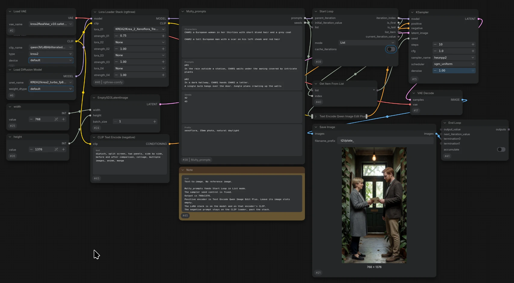

# Multy_prompts



A ComfyUI node that turns one character box, one shared prefix, and one prompt wall into one finished prompt and one seed per image. The node does not load a model and does not sample. Your existing graph runs once per plate.

Search for **Multy_prompts**. It is under **utilities → prompt**.

## Install

Copy this folder into `ComfyUI/custom_nodes/` and restart ComfyUI.

The graph also uses three built-in nodes:

| Node | Menu |
|---|---|
| Start Loop | utilities → looping |
| End Loop | utilities → looping |
| Get Item From List | utilities |

## What to add

Keep the model loader, CLIP, VAE, LoRAs, empty latent, negative prompt, sampler, decode, and Save Image that you already use. Add these four nodes:

1. **Multy_prompts**
2. **Start Loop**
3. **Get Item From List**
4. **End Loop**

Set **Start Loop** mode to **List**. On the sampler, set the seed control to **fixed**. **randomize** replaces the seed from this node.

Leave **Start Loop** `parent_iteration` and `initial_iteration_value` empty. Those are for a loop inside another loop, and for a value carried from pass to pass.

## Connections

**Multy_prompts** has two outputs. **Start Loop** can walk only one list, so the prompts use the loop and the seeds use **Get Item From List**.

| From | To |
|---|---|
| Multy_prompts `prompts` | Start Loop `list` |
| Start Loop `list_item` | positive text encoder `prompt` |
| Multy_prompts `seeds` | Get Item From List `list` |
| Start Loop `iteration_index` | Get Item From List `index` |
| Get Item From List output | sampler `seed` |
| Save Image `images` | End Loop `termination` |

Drag `list_item` onto the prompt text box, and drag the **Get Item From List** output onto the sampler seed box. That turns each widget into an input.

The positive encode, the sampler, the VAE decode, and Save Image sit between **Start Loop** and **End Loop**. One queue then writes one image per plate.

Model, CLIP, VAE, LoRAs, latent size, and the negative prompt stay outside the loop. They load once and are reused for every plate.

```
Multy_prompts.prompts ──► Start Loop.list
Start Loop.list_item  ──► positive text encoder.prompt ──► sampler ──► VAE Decode ──► Save Image
                                                                                        │
Multy_prompts.seeds   ──► Get Item From List.list                                        │
Start Loop.iteration_index ──► Get Item From List.index                                  │
Get Item From List ──► sampler.seed                                                      │
                                                                                        ▼
                                                                              End Loop.termination
```

## Prefix

Optional. Style text, LoRA triggers, or anything else that stays the same. It is pasted in front of every plate. A blank box adds nothing.

```
35mm photo, natural light, fine grain
```

`CHAR` tokens in the prefix are replaced the same way as in a plate. The plate id is still not included.

## Characters

Optional. Leave the box empty and the prompts go out unchanged.

One character per block. A blank line separates blocks. The block starts with the token. The description can follow on that same line, or on the lines under it. Write a phrase, because that phrase is pasted in place of the token.

```
CHAR1 A woman in her thirties with short black hair and a grey coat.

CHAR2
A tall man with a scar on his left cheek.
```

Tokens are `CHAR` plus a positive integer: `CHAR1`, `CHAR2`, `CHAR10`. `CHAR10` is not treated as `CHAR1`. A token with no character block is left as written. A prompt that never names a character is not rewritten.

## Prompts

Same headers as a PlatePress shot wall. A plate id on its own line starts the next image. Blank lines inside a plate stay in the text. The id is not sent to the sampler.

`p01` and `p01_station` both count. `p1` and `p001` are the same plate. Text after the id on that same line is the first line of the prompt.

```
p01
CHAR1 stands in the rain outside a station.

p02_letter
CHAR1 hands CHAR2 a letter in a dark hallway.
The hall is dark. A single bulb hangs over the door.
```

## Seeds

One line per plate, in the same order as the plates. An integer keeps that seed. An empty line chooses a seed when you queue. An empty box chooses a seed for every plate.

```
657539441289641

1001
```

The blank second line is a chosen seed for `p02`. The number of lines must match the number of plates.

## Sample workflow

`krea2_t2i_multy_prompts.json` is the text-to-image sample. Start Loop is in List mode, the sampler seed control is fixed, and the output is 768×1376. There is no reference image.

The positive encoder is **Text Encode Qwen Image Edit Plus**. Its image slots stay empty. The plate from Start Loop connects to its prompt. The negative stays on **CLIP Text Encode**, taken straight from the CLIP loader.

The model is `KREA2/krea2_turbo_fp8_scaled.safetensors`. **Lora Loader Stack (rgthree)** sits on the model and on the positive CLIP. Slot 1 is `KREA2/Krea_2_Xenoflora_Trees_tcrzit_BF16-3K.safetensors` at 0.75. That stack needs [rgthree-comfy](https://github.com/rgthree/rgthree-comfy).

The identity-edit graph, which keeps a person from a reference photo, is [krea2-ref-image-multy-prompts](https://github.com/JDJoe/krea2-ref-image-multy-prompts).

## Not in this version

Reference images are not an input on this node. A later version can attach a character image to every plate that names that character, and a scene image to one plate. The text path above does not have to change for that.
